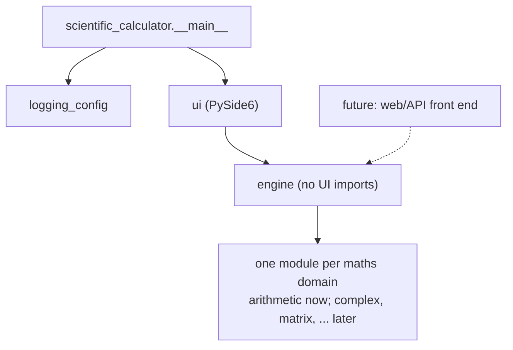

# Architecture (UML)

## Packages and modules

```mermaid
classDiagram
  direction TB
  namespace scientific_calculator {
    class __init__ {
      +__version__: str
    }
    class __main__ {
      +main(argv: list~str~ | None) int
    }
    class logging_config {
      +LOG_LEVEL_ENV_VAR: str
      +configure_logging() None
    }
  }
  namespace ui {
    class MainWindow {
      +MainWindow()
    }
  }
  namespace engine {
    class arithmetic {
      +add(a: float, b: float) float
    }
  }
  class QMainWindow
  QMainWindow <|-- MainWindow
  __main__ ..> logging_config : configures
  __main__ ..> MainWindow : creates
  MainWindow ..> __init__ : reads version
  MainWindow ..> engine : uses (later tasks)
```

## Dependency rule



- `engine` never imports `ui` or Qt (a test enforces it), so it can be reused by other front ends.
- A new maths domain is a new module or subpackage under `engine/`; existing domains are not edited.
